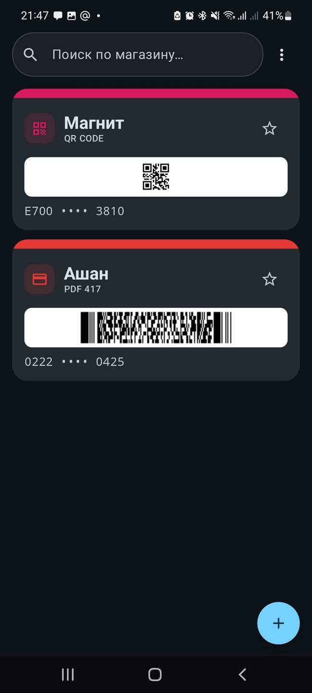
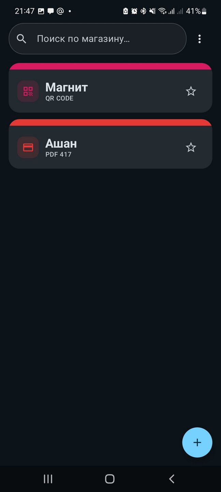
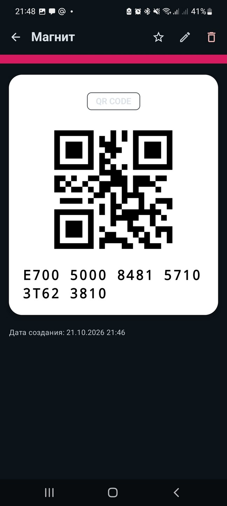
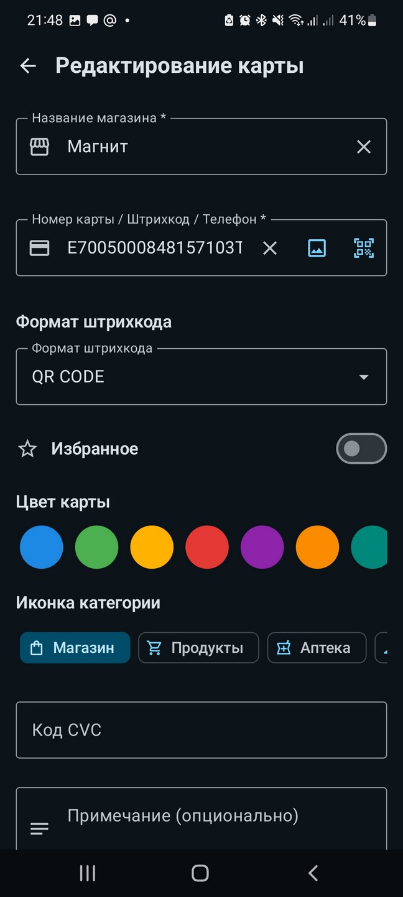
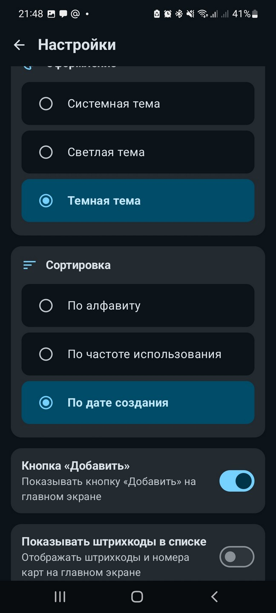
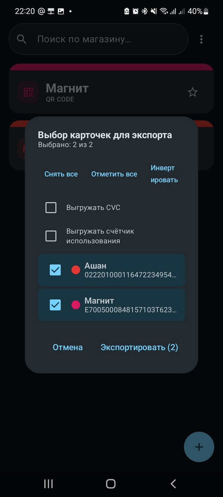
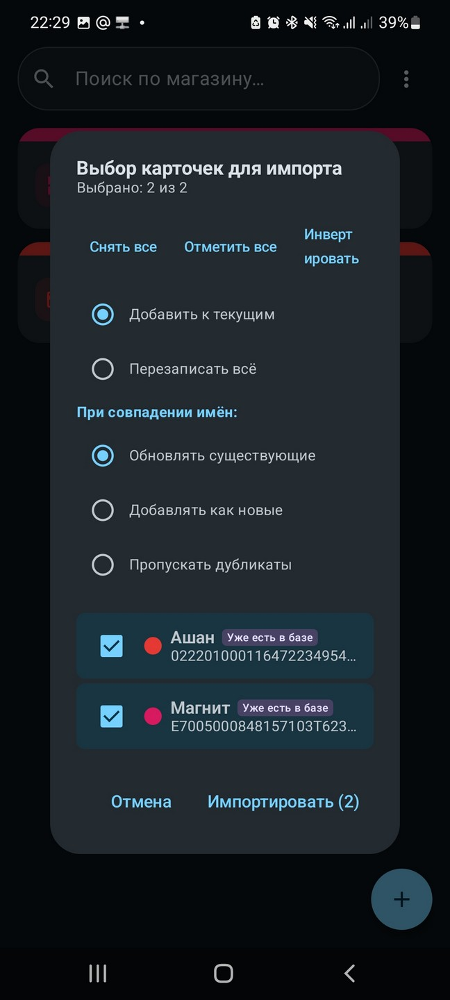
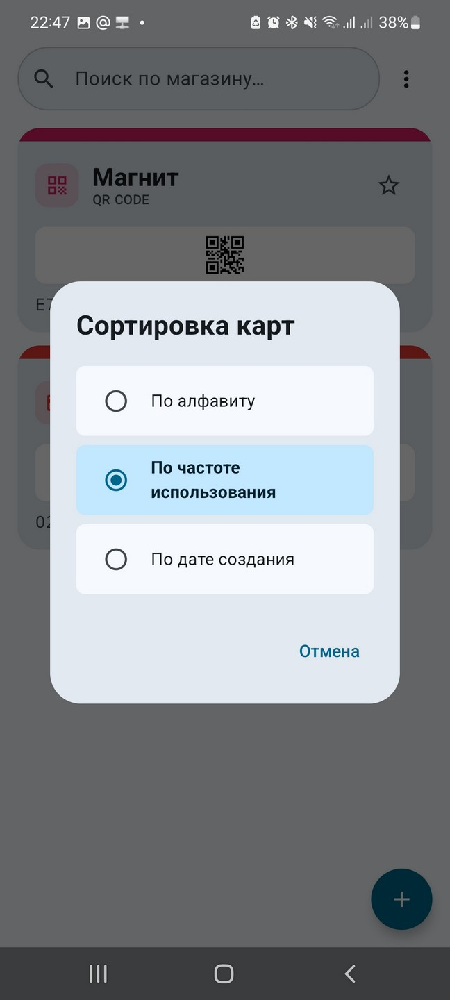

# DiscountCards

**DiscountCards** ist eine Android-App zum bequemen Speichern, Scannen und Verwenden von Kundenkarten und Rabattkarten. Die App ermöglicht es, alle Rabattkarten an einem Ort zu speichern, sie an der Kasse schnell mit einem Barcode-Generator zu scannen und Daten zu sichern.

> [!IMPORTANT]
> **Wichtigste Vorteile:**
> - ⚡️ **Sofortiger Start** — die App öffnet sich in einem Bruchteil einer Sekunde und ist direkt nach dem Start bereit zur Verwendung, ohne Ladezeit.
> - 🧩 **Schneller Barcode-Zugriff über ein Widget** — fügen Sie ein Widget mit dem ausgewählten Barcode auf Ihrem Startbildschirm hinzu und zeigen Sie es dem Kassierer, **ohne die App selbst zu öffnen**.
> - 📤 **Datenexport und -import** — erstellen Sie Sicherungskopien aller Karten im JSON- oder CSV-Format und stellen Sie sie auf einem beliebigen Gerät wieder her, oder teilen Sie Karten mit anderen.
> - 🚫 **Keine Werbung** — die App ist vollständig autark und enthält keine Werbung oder Tracking.

> [!TIP]
> **App herunterladen:**
> - 📦 **Release-APK herunterladen:** [GitHub Releases](https://github.com/Storvild/android_discount_cards/releases/latest)

---

## 📸 Bildschirmfotos

| Hauptbildschirm | Hauptbildschirm | Kartendetails | Hinzufügen / Scanner |
| :---: | :---: |:---------------------------------------------------------------------------:| :---: |
|  |  |  |  |

| Einstellungen | Karten exportieren | Karten importieren | Karten sortieren |
| :---: | :---: | :---: |:----------------------------------------------------------------------------------------------------------:|
|  |  |  |  |

---

## 📱 Hauptfunktionen

- 💳 **Verwaltung von Kundenkarten** — Hinzufügen, Bearbeiten und individuelles oder massenhaftes Löschen von Karten.
- 📷 **Barcode-Scan und Barcode-Auswahl aus einer Datei** — Scannen physischer Karten in Echtzeit mit der Kamera (CameraX + ML Kit) oder Auswahl eines Barcode-Bilds aus der Galerie/Datei.
- 🔢 **Unterstützung vieler Barcode-Formate** — Erstellen visueller Barcodes mit der ZXing-Bibliothek:
  - `QR_CODE`
  - `CODE_128`
  - `EAN_13` / `EAN_8`
  - `UPC_A`
  - `CODE_39`
  - `PDF_417`
  - `AZTEC`
  - `PHONE` (Rabatt über Telefonnummer — wird als Text angezeigt, nicht als Barcode erstellt)
- 🎨 **Personalisierung** — Auswahl der Kartenfarbe aus einer fertigen Palette oder einer freien Farbe über HSV-Palette und HEX-Code (`#RRGGBB`), Auswahl eines Kategorie-Symbols, Hinzufügen von Notizen und CVC/CVV-Codes.
- ⭐️ **Favoriten und Statistiken** — Markieren häufig genutzter Karten, automatisches Zählen der Aufrufe.
- 🔍 **Intelligente Suche** — schnelle Suche nach Ladenname, Kartennummer oder Notizen.
- 🔀 **Sortieren von Karten** — bequemes Sortieren der Liste nach Name, Erstellungsdatum oder Nutzungshäufigkeit.
> - ⚡️ **Kompakter Listenmodus** — Einstellung „Barcodes in der Liste anzeigen“ (standardmäßig aktiviert). Deaktivieren deaktiviert die Generierung von Barcodes und Kartennummern auf dem Hauptbildschirm, halbiert die Höhe der Listenelemente und beschleunigt Laden und Scrollen erheblich.
- 💡 **Bildschirmhelligkeit steuern** — automatische Einstellung des gewählten Helligkeitswerts beim Öffnen einer Karte sowie schnelle Anpassung direkt auf dem Kartenscreen über einen integrierten Regler (wird über die Option „Helligkeit auf Karte anzeigen“ in den Einstellungen aktiviert, standardmäßig deaktiviert).
- 📤 **Karten teilen** — Möglichkeit, ausgewählte Karten mit anderen Nutzern zu teilen.
- 🌐 **Sprachunterstützung** — getrennte Auswahl der Sprachoberfläche in den App-Einstellungen (11 Sprachen unterstützt).
- 🌗 **Designs** — Unterstützung für helles, dunkles und systembasiertes Design.
- 📦 **Sicherung (Export / Import)** — Speichern der Daten im **JSON**- oder **CSV**-Format:
  - Importmodi: **MERGE** (Zusammenführen) oder **OVERWRITE** (Überschreiben).
  - Flexible Strategien zur Bearbeitung von Duplikaten: *Bestehende aktualisieren*, *Als neue hinzufügen*, *Überspringen*.
  - 📂 **Öffnen von Sicherungsdateien („Mit öffnen“)** — Unterstützung für das direkte Öffnen oder Senden (`ACTION_VIEW`, `ACTION_SEND`) von (JSON)-Dateien aus Datei-Verwaltern mit automatischem Start des Karten-Import-Dialogs.
- 🗃️ **Kartenarchiv** — Verschieben ungenutzter Karten in einen eigenen Abschnitt:
  - Button **„Ins Archiv verschieben“** auf dem Detailbildschirm einer aktiven Karte und Button **„Aus dem Archiv extrahieren“** auf dem Detailbildschirm einer archivierten Karte.
  - Eintrag **„Archiv“** im Dropdown-Menü des Hauptbildschirms öffnet einen separaten Bildschirm mit Suche, Liste und Leerzustand.
  - Archivierte Karten werden aus der Hauptliste, der Suche, dem Export und dem Teilen (Share) ausgeblendet.
- 🧩 **Widgets auf dem Startbildschirm** — anpassbares Widget (von 1x1 bis 5x5) mit Kartenwahl, Barcode/QR und Ladenname, Button zum Bearbeiten der Parameter und schnellem Öffnen der Karte per Tippen.
- 👆 **Kontextmenü per Langdrücken** — schneller Zugriff auf die Aktionen „Bearbeiten“ und „Löschen“ beim Langdrücken einer Karte in der Liste.
- 📱 **Edge-to-Edge-UI** — moderne, adaptive Benutzeroberfläche unter Berücksichtigung der Systemleisten, basierend auf Material 3 und Jetpack Compose Adaptive.

---

## 🌐 Unterstützte Sprachen
- **Russisch**
- **Englisch (English)**
- **Französisch (Français)**
- **Deutsch**
- **Japanisch (日本語)**
- **Spanisch (Español)**
- **Portugiesisch (Português)**
- **Hindi (हिन्दी)**
- **Arabisch (العربية)**
- **Türkisch (Türkçe)**
- **Vereinfachtes Chinesisch (简体中文)**

---

## 💾 Sicherung und Datenformat

Die App unterstützt zwei Formate: **JSON** und **CSV**.

### JSON

```json
[
  {
    "id": 1,
    "storeName": "Pyaterochka",
    "cardNumber": "1234567890123",
    "barcodeFormat": "EAN_13",
    "note": "Familienkarte",
    "cardColor": "#0EE8A5",
    "iconName": "shopping_cart",
    "isFavorite": true,
    "cvc": "123",
    "usageCount": 5,
    "createdAt": "2026-01-01T10:10:10",
    "updatedAt": "2026-01-01T10:10:10",
    "isArchived": false
  }
]
```

### CSV

Tabelle mit der Kopfzeile `Name,Code,CodeTyp,CVC,Notiz`:

```csv
Name,Code,CodeTyp,CVC,Notiz
Pyaterochka,1234567890123,EAN_13,123,Familienkarte
Magnit,9876543210,QR_CODE,,
```

### Importmodi:
- **MERGE (Zusammenführen)** — Hinzufügen der Karten aus der Datei zu den bereits vorhandenen in der Datenbank.
- **OVERWRITE (Überschreiben)** — vollständiger Ersatz der aktuellen Karten durch die Daten aus der Datei.

### Strategien zur Konfliktlösung bei doppelten Karten:
- **UPDATE_EXISTING (Bestehende aktualisieren)** — Aktualisierung der Kartendaten.
- **ADD_AS_NEW (Als neue hinzufügen)** — Erstellen einer neuen Duplikat-Karte.
- **SKIP (Überspringen)** — Überspringen des Duplikats.

---

## 🔒 Datenschutz und Autarkie

**DiscountCards** ist eine vollständig **offline** arbeitende App. Sie **bittet grundsätzlich nicht** um die Berechtigung für Internetzugriff (`android.permission.INTERNET`).

**Was dem Nutzer das bringt:**
- 🛡 **Absolute Privatsphäre:** Alle Daten Ihrer Karten, der Verlaufsverlauf und die Sicherungen werden lokal auf Ihrem Gerät gespeichert. Nichts wird an fremde Server gesendet.
- 🚫 **Keine Werbung:** ohne Internet ist es physikalisch unmöglich, Werbung oder Tracking zu laden und anzuzeigen.
- 🔋 **Batterieeinsparung:** keine versteckten Hintergrund-Synchronisierungen oder Netzwerk-Anfragen, die Akku und Mobile-Daten verbrauchen.
- ✈️ **Unabhängigkeit vom Netz:** Karten werden sofort geladen und erstellen Barcodes überall: selbst in den Betonboxen der Supermärkte oder Kellern ohne Mobilfunkabdeckung.

## 📋 Erforderliche Berechtigungen

Die App benötigt nur einen einzigen Zugriff, und zwar nur auf Anfrage:

| Berechtigung | Zweck |
|---|---|
| `android.permission.CAMERA` | Scannen von Barcodes von physischen Karten (optional, wird nur beim Scannen angefragt, `uses-feature required="false"`). |

---

## 🛠 Für Entwickler

Technische Informationen zur Architektur, dem Technologie-Stack, der Projektstruktur, dem Datenspeicherformat und den Build-Befehlen wurden in ein separates Dokument verlagert:

👉 [**Dokumentation für Entwickler**](../../DEVELOPMENT.md)

---

## 📄 Lizenz

Das Projekt wird unter den Bedingungen der Lizenz bereitgestellt, die in der Datei [LICENSE](../../../LICENSE) angegeben ist.
