# DiscountCards

**DiscountCards** é um aplicativo Android para armazenar, escanear e usar de forma confortável seus cartões de fidelidade e descontos. O aplicativo permite manter todos seus cartões de desconto em um só lugar, escaneá-los rapidamente no caixa usando um gerador de código de barras e fazer cópias de segurança dos seus dados.

> [!IMPORTANT]
> **Principais vantagens:**
> - ⚡️ **Início instantâneo** — o aplicativo abre em uma fração de segundo e está pronto para uso imediatamente após o lançamento, sem tempo de espera.
> - 🧩 **Acesso rápido ao código de barras por widget** — adicione um widget com o código de barras selecionado à sua tela inicial e apresente-o ao caixa **sem abrir o próprio aplicativo**.
> - 📤 **Exportação e importação de dados** — crie cópias de segurança de todos os seus cartões no formato JSON ou CSV e restaure-os em qualquer dispositivo, ou compartilhe seus cartões com outros.
> - 🚫 **Sem anúncios** — o aplicativo é totalmente autônomo e não contém nenhum anúncio ou rastreadores.

> [!TIP]
> **Baixar o aplicativo:**
> - 📦 **Baixar o APK da versão:** [GitHub Releases](https://github.com/Storvild/android_discount_cards/releases/latest)

---

## 📸 Capturas de tela

| Tela principal | Tela principal | Detalhes do cartão | Adicionar / Scanner |
| :---: | :---: |:---------------------------------------------------------------------------:| :---: |
| 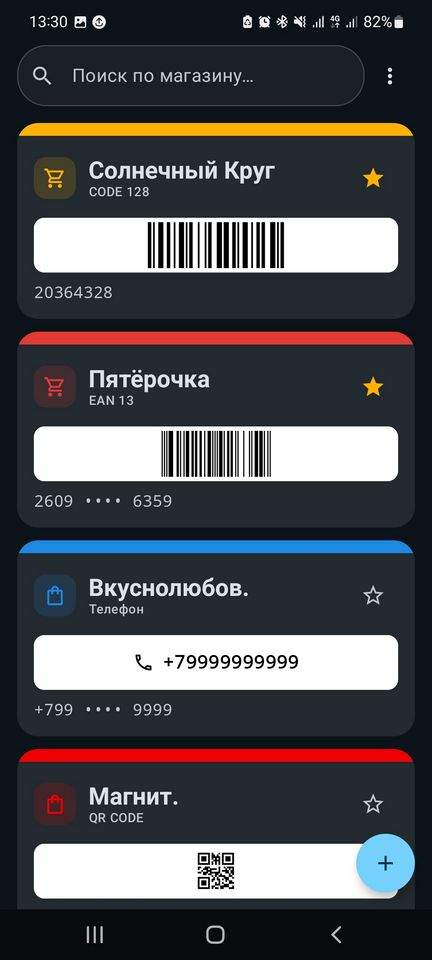 | 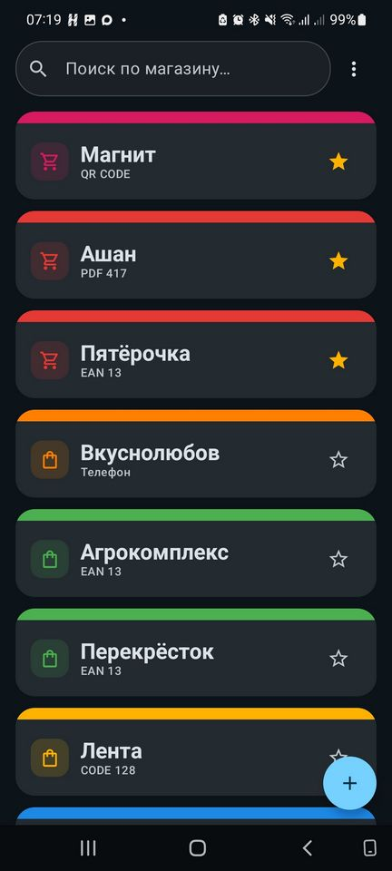 | 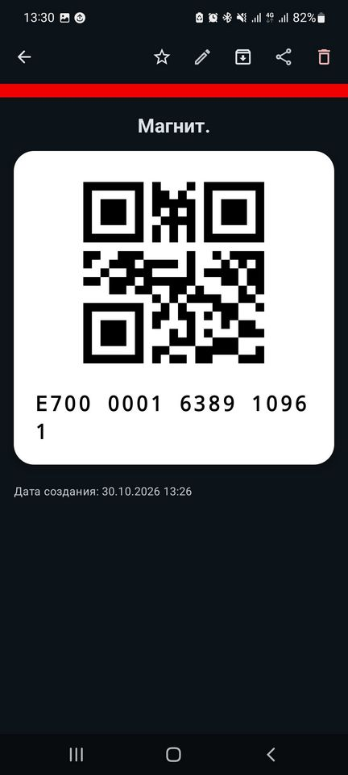 | 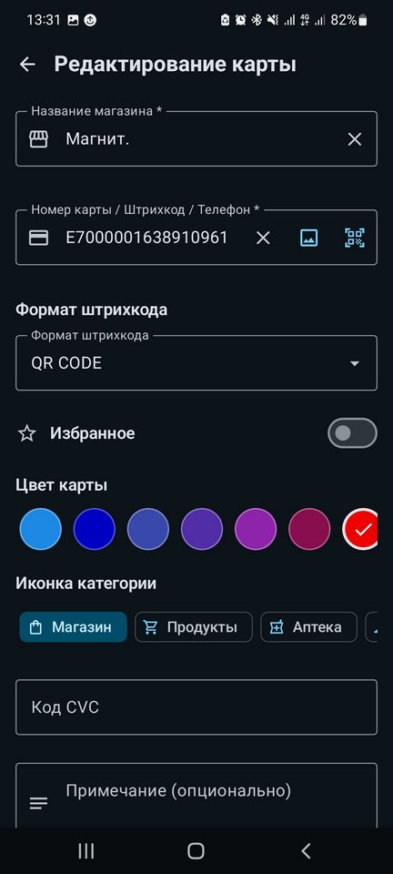 |

| Configurações | Exportar cartões | Importar cartões | Ordenação dos cartões |
| :---: | :---: | :---: |:----------------------------------------------------------------------------------------------------------:|
| 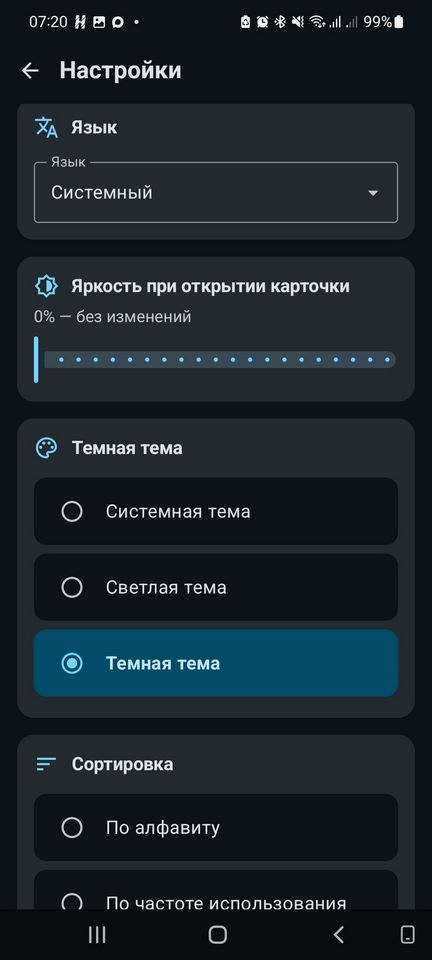 | 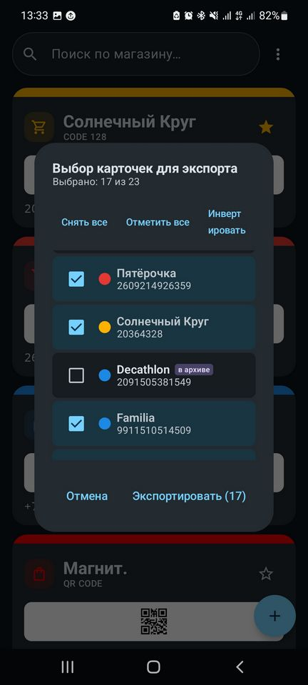 | 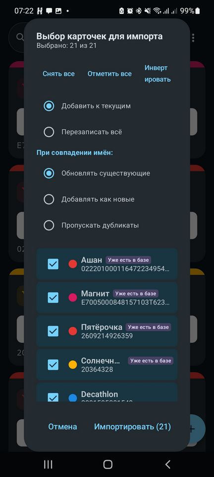 | 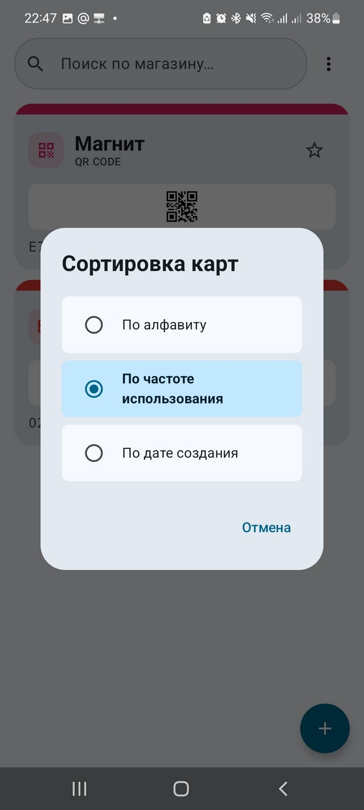 |

| Menu | Configurações 2 | Widget 1 | Widget 2 |
| :---: | :---: | :---: |:----------------------------------------------------------------------------------------------------------:|
| 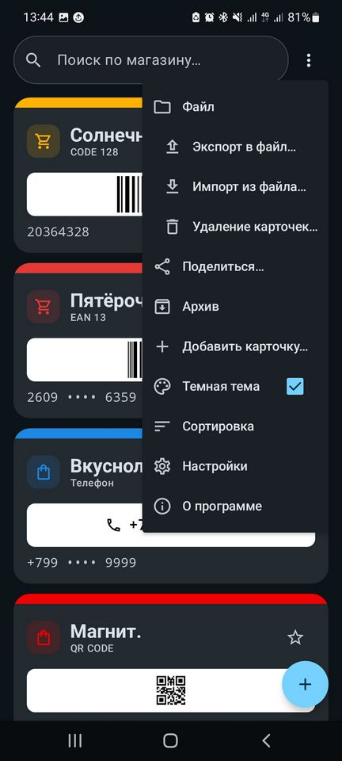 | 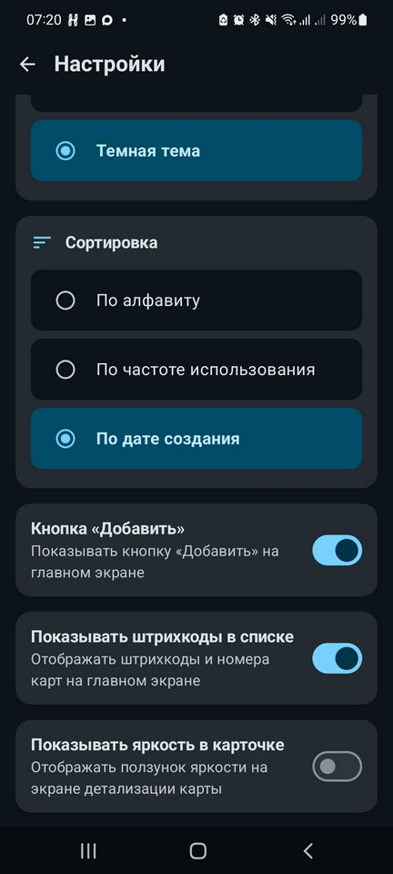 | 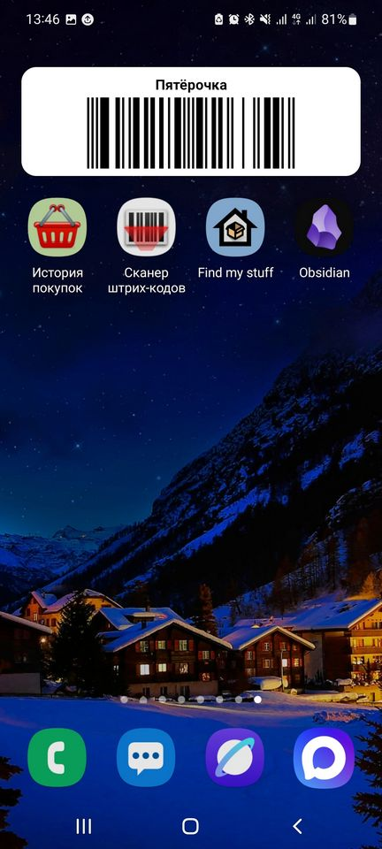 | 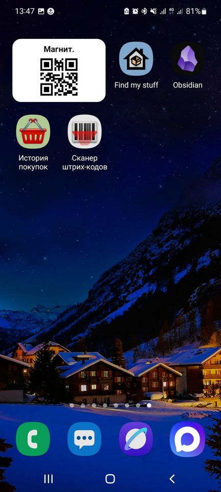 |

---

## 📱 Principais funcionalidades

- 💳 **Gerenciamento de cartões de fidelidade** — adição, edição e exclusão individual ou em massa de cartões.
- 📷 **Escaneamento e seleção de código de barras a partir de um arquivo** — escaneamento de cartões físicos em tempo real com a câmera (CameraX + ML Kit) ou seleção de uma imagem de código de barras da galeria/arquivo.
- 🔢 **Suporte a múltiplos formatos de código de barras** — geração de códigos de barras visuais com a biblioteca ZXing:
  - `QR_CODE`
  - `CODE_128`
  - `EAN_13` / `EAN_8`
  - `UPC_A`
  - `CODE_39`
  - `PDF_417`
  - `AZTEC`
  - `PHONE` (desconto por número de telefone — exibido como texto, não gerado como código de barras)
- 🎨 **Personalização** — escolha da cor do cartão a partir de uma paleta pronta ou de uma cor livre via paleta HSV e código HEX (`#RRGGBB`), escolha de um ícone de categoria, adição de notas e códigos CVC/CVV.
- ⭐️ **Favoritos e estatísticas** — marcar cartões usados com frequência, contagem automática do número de visualizações.
- 🔍 **Busca inteligente** — busca rápida por nome da loja, número do cartão ou notas.
- 🔀 **Ordenação dos cartões** — ordenação conveniente da lista por nome, data de criação ou frequência de uso.
> - ⚡️ **Modo de lista compacta** — configuração «Mostrar códigos de barras na lista» (ativada por padrão). Ao desativá-la, desativa-se a geração de códigos de barras e números de cartão na tela principal, reduzindo à metade a altura dos itens da lista e acelerando significativamente o carregamento e o rolagem.
- 💡 **Controle do brilho da tela** — configuração automática do nível de brilho selecionado ao abrir um cartão, além de ajuste rápido diretamente na tela do cartão usando um controle deslizante integrado (ativado pela opção «Mostrar brilho no cartão» nas configurações, desativado por padrão).
- 📤 **Compartilhamento de cartões** — possibilidade de compartilhar os cartões selecionados com outros usuários.
- 🌐 **Suporte de idiomas** — seleção separada do idioma da interface nas configurações do aplicativo (11 idiomas suportados).
- 🌗 **Temas** — suporte a tema claro, escuro e do sistema.
- 📦 **Cópia de segurança (Exportação / Importação)** — armazenamento dos dados no formato **JSON** ou **CSV**:
  - Modos de importação: **MERGE** (Mesclar) ou **OVERWRITE** (Substituir).
  - Estratégias flexíveis para lidar com duplicatas: *Atualizar existentes*, *Adicionar como novos*, *Ignorar*.
  - 📂 **Abertura de arquivos de backup («Abrir com»)** — suporte à abertura direta ou envio (`ACTION_VIEW`, `ACTION_SEND`) de arquivos (JSON) a partir de gerenciadores de arquivos, com abertura automática do diálogo de importação de cartões.
- 🗃️ **Arquivo de cartões** — transferência de cartões não usados para uma seção separada:
  - Botão **«Mover para o arquivo»** na tela de detalhes de um cartão ativo e **«Extrair do arquivo»** na tela de detalhes de um cartão arquivado.
  - Item **«Arquivo»** no menu suspenso da tela principal que abre uma tela separada com busca, lista e estado vazio.
  - Os cartões arquivados são ocultados da lista principal, da busca, da exportação e do compartilhamento (Share).
- 🧩 **Widgets na tela inicial** — widget redimensionável (de 1x1 a 5x5) com seleção de cartão, código de barras/QR e nome da loja, botão para editar os parâmetros e abertura rápida do cartão ao toque.
- 👆 **Menu contextual por pressionar longamente** — acesso rápido às ações «Editar» e «Excluir» ao pressionar longamente um cartão na lista.
- 📱 **UI Edge-to-Edge** — interface moderna e adaptável que leva em conta os painéis do sistema, baseada no Material 3 e no Jetpack Compose Adaptive.

---

## 🌐 Idiomas suportados
- **Russo**
- **Inglês (English)**
- **Francês (Français)**
- **Alemão (Deutsch)**
- **Japonês (日本語)**
- **Espanhol (Español)**
- **Português**
- **Hindi (हिन्दी)**
- **Árabe (العربية)**
- **Turco (Türkçe)**
- **Chinês simplificado (简体中文)**

---

## 💾 Cópia de segurança e formato de dados

O aplicativo suporta dois formatos: **JSON** e **CSV**.

### JSON

```json
[
  {
    "id": 1,
    "storeName": "Pyaterochka",
    "cardNumber": "1234567890123",
    "barcodeFormat": "EAN_13",
    "note": "Cartão da família",
    "cardColor": "#0EE8A5",
    "iconName": "shopping_cart",
    "isFavorite": true,
    "cvc": "123",
    "usageCount": 5,
    "createdAt": "2026-01-01T10:10:10",
    "updatedAt": "2026-01-01T10:10:10",
    "isArchived": false
  }
]
```

### CSV

Tabela com o cabeçalho `Nome,Codigo,TipodeCodigo,CVC,Nota`:

```csv
Nome,Codigo,TipodeCodigo,CVC,Nota
Pyaterochka,1234567890123,EAN_13,123,Cartao da familia
Magnit,9876543210,QR_CODE,,
```

### Modos de importação:
- **MERGE (Mesclar)** — adiciona os cartões do arquivo aos já existentes no banco de dados.
- **OVERWRITE (Substituir)** — substitui totalmente os cartões atuais pelos dados do arquivo.

### Estratégias de resolução de conflitos para cartões duplicados:
- **UPDATE_EXISTING (Atualizar existentes)** — atualiza as informações do cartão.
- **ADD_AS_NEW (Adicionar como novos)** — cria um novo cartão duplicado.
- **SKIP (Ignorar)** — ignora o duplicado.

---

## 🔒 Privacidade e autonomia

**DiscountCards** é um aplicativo **totalmente offline**. Ele **não solicita** a permissão de acesso à Internet (`android.permission.INTERNET`).

**O que isso dá ao usuário:**
- 🛡 **Privacidade absoluta:** todos os dados dos seus cartões, o histórico de uso e as cópias de segurança são armazenados localmente no seu dispositivo. Nada é enviado para servidores de terceiros.
- 🚫 **Sem anúncios:** sem Internet, é fisicamente impossível carregar e exibir anúncios ou rastreadores.
> - 🔋 **Economia de bateria:** não há sincronizações ocultas em segundo plano nem requisições de rede que consumam bateria e dados móveis.
- ✈️ **Independência da rede:** os cartões são carregados instantaneamente e geram códigos de barras em qualquer lugar: até nas caixas de concreto dos supermercados ou porões sem cobertura de celular.

## 📋 Permissões requeridas

O aplicativo requer apenas um único acesso, e até mesmo este sob solicitação:

| Permissão | Finalidade |
|---|---|
| `android.permission.CAMERA` | Escaneamento de códigos de barras de cartões físicos (opcional, solicitado apenas no momento do escaneamento, `uses-feature required="false"`). |

---

## 🛠 Para desenvolvedores

Informações técnicas sobre a arquitetura, a stack de tecnologia, a estrutura do projeto, o formato de armazenamento de dados e os comandos de compilação foram movidas para um documento separado:

👉 [**Documentação para desenvolvedores**](../../DEVELOPMENT.md)

---

## 📄 Licença

O projeto é distribuído sob as condições da licença especificadas no arquivo [LICENSE](../../../LICENSE).
